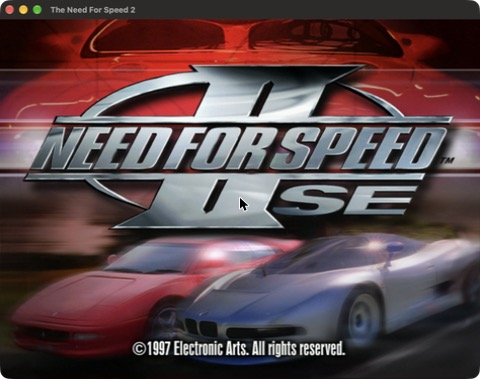
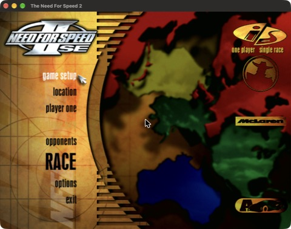

**DISCLAIMER**

Readme and CMakeLists mostly AI-generated.

# nfs-recompiled-mac

A native **macOS (Apple Silicon)** port of [motor-dev/nfs-recompiled](https://github.com/motor-dev/nfs-recompiled), the static recompilation of **Need for Speed II: Special Edition** and **Need for Speed III: Hot Pursuit** from their original Win32 x86 executables into portable C++. No Wine, no Rosetta: the games run as arm64 binaries and install straight from the CD image.

<a href="screenshots/nfsiise-macos-title.jpg"></a>
<a href="screenshots/nfsiise-macos-menu.jpg"></a>
<a href="screenshots/nfsiise-macos.jpg"></a>

### Status
| Game | macOS |
|---|---|
| NFS II SE | Plays: intro, menus, races and sound tested on an M1 Pro |
| NFS III HP | Builds; not tested yet, and the install script does not handle its CD yet |

## Requirements
- A Mac with Apple Silicon and macOS 11 or later
- The original CD image of the game (`.iso`). Game data is not included.

## Install from the release
1. Download `nfs-recompiled-mac-arm64.zip` from the [latest release](https://github.com/mnmt25/nfs-recompiled-mac/releases/latest) and unzip it.
2. The binaries are not notarized by Apple, so clear the download quarantine in Terminal (otherwise macOS blocks the app the first time; you can then allow it under System Settings → Privacy & Security):
   ```bash
   xattr -dr com.apple.quarantine ~/Downloads/nfs-recompiled-mac-arm64
   ```
3. Install the game from your CD image:
   ```bash
   ~/Downloads/nfs-recompiled-mac-arm64/install-from-iso.sh "Need for Speed II SE.iso" ~/Games/nfs2se
   ```
   This mounts the image read-only, copies the game data to `~/Games/nfs2se` and creates `~/Applications/Need for Speed II SE.app`.
4. Open **Need for Speed II SE** from Launchpad or Spotlight.

After installing, the unzipped folder is no longer needed: the app carries its own copy of the game and SDL3.

## Build from source
```bash
brew install cmake sdl3 simde
cmake -B build -DCMAKE_BUILD_TYPE=Release
cmake --build build -j
scripts/install-from-iso.sh "Need for Speed II SE.iso" ~/Games/nfs2se
```
The build takes a couple of minutes: the generated sources are over 100 MB. The install script picks up `build/nfs2se` for the app, so after rebuilding, run it again to refresh the app.

| CMake option | Default | Description |
|---|---|---|
| `WITH_MMX` | `ON` | Enable MMX instruction support |

`WITH_PEDANTIC_FPU` is not available on macOS: its NASM helper is x86-64 ELF only.

## Install script options
Options go before the image path:

| Option | Default | Description |
|---|---|---|
| `-l language` | `english` | Game language: `english`, `german`, `french`, `spanish`, `italian` or `swedish` |
| `-a dir` | `~/Applications` | Where to create the `.app` |
| `-b binary` | `build/nfs2se`, or the one next to the script | Game binary to put in the `.app` |

The script also accepts a directory with the CD contents instead of the `.iso`.

## Running from Terminal
The app is the easiest way to play, but the binary can also be started directly. Its arguments locate the data:

| Arguments | Example | Behavior |
|---|---|---|
| **0 args** | `./nfs2se` | Uses the executable's directory for both game data and "CD" files |
| **1 arg** | `./nfs2se ~/Games/nfs2se` | Uses that path for both game data and "CD" files |
| **2 args** | `./nfs2se ~/Games/nfs2se /Volumes/NFSIISE` | Separate paths for the installed files and the CD contents |

Game messages, such as the optional files it did not find, are printed to the terminal.

## What this fork changes
- **Native arm64 build**: the MMX/SSE2 intrinsics go through [SIMDe](https://github.com/simd-everywhere/simde) (NEON), the emulated memory works with the 16 KiB pages of Apple Silicon, and there is no x86 inline assembly left.
- **OpenGL 4.1 core renderer**, the newest profile macOS offers, for both the DirectDraw path and the Glide 2x translation.
- **Cocoa threading**: the games create their window and run their message loop on threads of their own, which macOS does not allow, so the game runs on a worker thread while the main thread owns the window and the event loop.
- **Install from the CD image**: `scripts/install-from-iso.sh` copies the data, writes `install.win` and creates a `.app` with the icon the original installer gave its shortcut.

## How it works
1. **Python disassembler** (`disasm/`) — Uses Capstone to disassemble the original `.exe` and `.dll` files and emit C++ source files that reproduce the original program logic as function calls on a virtual CPU.
2. **Virtual x86 CPU** — A `x86::CPU` struct (`include/cpu.h`) with general-purpose registers, flags, an x87 FPU and MMX support.
3. **Win32 API layer** — Minimal, native C++ reimplementations of 18 Win32 API modules (kernel32, user32, gdi32, DirectDraw, DirectInput, DirectSound, Glide 2x, etc.) provide the runtime environment the original code needs.
4. **SDL3 + OpenGL backend** — Platform services (windowing, audio, input, file I/O, timers, threads) are implemented on top of SDL3. The Glide 2x renderer translates 3Dfx draw calls into OpenGL 4.1 core.

| Game | Original executable | Target |
|---|---|---|
| NFS II: SE | `nfs2se/nfs2sen.exe` | `nfs2se` |
| NFS III: HP | `nfs3hp/nfs3.exe` | `nfs3hp` |

## Regenerating the disassembled files
The repository contains pre-generated C++ code in `src/nfs2se/disassembly` and `src/nfs3hp/disassembly`, so you do not need to run the disassembler to build. If you modify the disassembly logic in `disasm/`, regenerate the sources:

1. Place the original executables and DLLs:
   * **NFS II SE**: `nfs2sen.exe` and `eacsnd.dll` in `nfs2se/`
   * **NFS III HP**: `nfs3.exe`, `eacsnd.dll`, `softtria.dll` and `voodoo2a.dll` in `nfs3hp/`
2. Install Capstone and run the generators:
   ```bash
   python3 -m pip install capstone
   python3 disassemble_nfs2se.py
   python3 disassemble_nfs3hp.py
   ```

## File tree
```
disasm/                  Python disassembly framework
  codegen/               x86 instruction -> C++ code generators
  ordlookup/             DLL ordinal-to-name lookup tables
disassemble_nfs2se.py    Disassembly driver for NFS II: SE
disassemble_nfs3hp.py    Disassembly driver for NFS III: HP
include/
  cpu.h                  Virtual x86 CPU struct (registers, flags)
  fpu.h                  x87 FPU emulation
  mmx.h                  MMX instruction support (SIMDe on Apple Silicon)
  x86.h                  Base register types and utility macros
  lib/                   Platform abstraction headers
  winapi/                Win32 API reimplementation headers
src/
  lib/                   Shared runtime library (nfs_core)
    sdl-backend/         SDL3 platform backend (file, audio, events, etc.)
    winapi/              Win32 API implementations
  nfs2se/                NFS II: SE entry point + generated disassembly
  nfs3hp/                NFS III: HP entry point + generated disassembly
scripts/                 Install from the CD image and .app creation
nfs2se/                  Original executables that can be decompiled for NFS2: SE
nfs3hp/                  Original executables that can be decompiled for NFS3: HP
```
