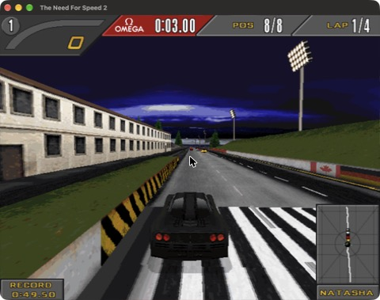

**DISCLAIMER**

Readme and CMakeLists mostly AI-generated.

# nfs-recompiled-mac

A native **macOS (Apple Silicon)** port of [motor-dev/nfs-recompiled](https://github.com/motor-dev/nfs-recompiled), the static recompilation of **Need for Speed II: Special Edition** and **Need for Speed III: Hot Pursuit** from their original Win32 x86 executables into portable C++. No Wine, no Rosetta: the games build as arm64 binaries and install straight from the CD image.

<a href="screenshots/nfsiise-macos.jpg"></a>

### What this fork adds
- **Native arm64 build**: the MMX/SSE2 intrinsics go through [SIMDe](https://github.com/simd-everywhere/simde) (NEON), the emulated memory works with the 16 KiB pages of Apple Silicon, and there is no x86 inline assembly left on ARM.
- **OpenGL 4.1 core renderer**, the newest profile macOS offers, for both the DirectDraw path and the Glide 2x translation.
- **Cocoa threading**: the games create their window and run their message loop on threads of their own, which macOS does not allow, so the game runs on a worker thread while the main thread owns the window and the event loop.
- **Install from the CD image**: `scripts/install-from-iso.sh` copies the data, writes `install.win` and creates a `.app` with the icon the original installer gave its shortcut.

### Status
| Game | macOS |
|---|---|
| NFS II SE | Plays: intro, menus, races and sound tested on an M1 Pro |
| NFS III HP | Builds; not tested yet, and the install script does not handle its CD yet |

The Linux and Windows code paths are meant to behave as upstream, but this fork has only been tested on macOS.

## Quick Start on macOS
```bash
brew install cmake sdl3 simde
cmake -B build -DCMAKE_BUILD_TYPE=Release
cmake --build build -j
scripts/install-from-iso.sh "Need for Speed II SE.iso" ~/Games/nfs2se
```
The last step mounts the image read-only, copies the game data to `~/Games/nfs2se` and creates `~/Applications/Need for Speed II SE.app`, which you can open from Launchpad or Spotlight. The app carries its own copy of the game binary and SDL3, so rebuilding means running the script again.

Script options, given before the image path:

| Option | Default | Description |
|---|---|---|
| `-l language` | `english` | Game language: `english`, `german`, `french`, `spanish`, `italian` or `swedish` |
| `-a dir` | `~/Applications` | Where to create the `.app` |
| `-b binary` | `build/nfs2se` | Game binary to put in the `.app` |

Upstream documentation follows.

## Upstream screenshots (Linux)

<a href="screenshots/nfsiise-1.png"></a>

<a href="screenshots/nfsiise-2.png"></a>

<a href="screenshots/nfsiise-3.png"></a>

<a href="screenshots/nfsiiihp-1.png"></a>

<a href="screenshots/nfsiiihp-2.png"></a>

## Quick Start: Running the Game

If you have obtained a release binary, here is how to get the game running.

### 1. Game Data
You need the original game files.

**From the CD image (NFS II SE, no Wine needed):** the CD keeps its data uncompressed, so `scripts/install-from-iso.sh` copies it and writes `install.win`. On macOS it mounts the `.iso` itself; elsewhere pass the directory where the CD is mounted:
```bash
scripts/install-from-iso.sh /mnt/cdrom ~/games/nfs2se
```

**Through the original installer:**
1.  **Install the game** from your original CD (or mount the iso).
    On Linux, install the game from the CD-ROM through Wine, e.g. `WINEARCH=win32 WINEPREFIX=/opt/win98 wine /mnt/AUTORUN.EXE`
2.  **Copy CD data**: The game expects certain files to be on the CD. To run without the CD, copy the `Fedata` and `GameData` folders from the CD-ROM into your game installation directory (merging with existing folders if necessary).
    *   *Tip*: You can check the `install.win` file in your installation directory. It lists paths; any path starting with a drive letter (like `D:\`) needs to be present on your disk relative to the executable for portable play.

### 2. Running
Run the executable from the terminal. The game supports positional arguments to locate data files.

| Arguments | Behavior |
|---|---|
| **0 args** | `./nfs3hp` | Uses the current directory for both game data and "CD" files. |
| **1 arg** | `./nfs3hp /path/to/game` | Uses the specified path for both game data and "CD" files. |
| **2 args** | `./nfs3hp /path/to/install /path/to/cdrom` | Specifies separate paths for the installed files and the CD-ROM content. |

**Examples:**
```bash
# Data and executable in the same folder
$ ./nfs3hp

# Executable separate from data
$ ./build/nfs3hp /home/user/games/nfs3

# Separate install and CD mount
$ ./build/nfs2se /home/user/games/nfs2 /mnt/cdrom
```

## Building from source

### Prerequisites
- CMake ≥ 3.15
- A C++17 compiler (GCC or Clang)
- SDL3 development libraries
- OpenGL development libraries
- NASM (only for `WITH_PEDANTIC_FPU`)
- SIMDe (only on non-x86 hosts such as Apple Silicon)
- Python 3 (only if regenerating disassembly)

**Debian / Ubuntu:**
```bash
sudo apt install build-essential cmake nasm python3 python3-pip \
               libsdl3-dev libgl-dev
```

**macOS (Apple Silicon):**
```bash
brew install cmake sdl3 simde
```
`WITH_PEDANTIC_FPU` is not available on macOS: its NASM helper is x86-64 ELF only.

### Build Instructions
Windows users with the bundled SDL3 library can point CMake at the `/sdl3` subdirectory (this is done automatically if you configure from within the project root).

```bash
cmake -B build -DCMAKE_BUILD_TYPE=Release
cmake --build build
```

### CMake Options
| Option | Default | Description |
|---|---|---|
| `WITH_PEDANTIC_FPU` | `OFF` | Use strict 80-bit extended-precision FPU emulation. Required for NFS3 software renderer glitches on Linux. |
| `WITH_MMX` | `ON` | Enable MMX instruction support. |

Example:
```bash
cmake -B build -DWITH_PEDANTIC_FPU=ON
```

## Regenerating Disassembled Files

The repository contains pre-generated C++ code in `src/nfs2se/disassembly` and `src/nfs3hp/disassembly`. You do not need to run the disassembler to build the project.

If you modify the disassembly logic in `disasm/`, you must regenerate the sources:

1.  Ensure you have the original executables and DLLs:
    *   **NFS II SE**: Place `nfs2sen.exe` and `eacsnd.dll` in the `nfs2se/` folder.
    *   **NFS III HP**: Place `nfs3.exe`, `eacsnd.dll`, `softtria.dll`, and `voodoo2a.dll` in the `nfs3hp/` folder.
2.  Install Python dependencies:
    ```bash
    pip3 install capstone
    ```
3.  Run the generation scripts:
    ```bash
    python3 disassemble_nfs2se.py
    python3 disassemble_nfs3hp.py
    ```

## Project Structure

### Supported Games
| Game | Executable | Generated Target |
|---|---|---|
| NFS II: SE | `nfs2se/nfs2sen.exe` | `nfs2se` |
| NFS III: HP | `nfs3hp/nfs3.exe` | `nfs3hp` |

### How it works
1. **Python disassembler** (`disasm/`) — Uses Capstone to disassemble the original `.exe` and `.dll` files and emit C++ source files that reproduce the original program logic as function calls on a virtual CPU.
2. **Virtual x86 CPU** — A `x86::CPU` struct (`include/cpu.h`) with general-purpose registers, flags, a full x87 FPU (with optional 80-bit extended precision via NASM routines), and MMX support.
3. **Win32 API layer** — Minimal, native C++ reimplementations of 18 Win32 API modules (kernel32, user32, gdi32, DirectDraw, DirectInput, DirectSound, Glide 2x, etc.) provide the runtime environment the original code needs.
4. **SDL3 + OpenGL backend** — Platform services (windowing, audio, input, file I/O, timers, threads) are implemented on top of SDL3. The Glide 2x renderer translates 3Dfx draw calls into OpenGL 4.1 core.

### File Tree
```
disasm/                  Python disassembly framework
  codegen/               x86 instruction -> C++ code generators
  ordlookup/             DLL ordinal-to-name lookup tables
disassemble_nfs2se.py    Disassembly driver for NFS II: SE
disassemble_nfs3hp.py    Disassembly driver for NFS III: HP
include/
  cpu.h                  Virtual x86 CPU struct (registers, flags)
  fpu.h                  x87 FPU emulation (80-bit extended precision)
  mmx.h                  MMX instruction support
  x86.h                  Base register types and utility macros
  lib/                   Platform abstraction headers
  winapi/                Win32 API reimplementation headers
    ddraw/               IDirectDraw interfaces
    dinput/              IDirectInput interfaces
    dsound/              IDirectSound interfaces
src/
  lib/                   Shared runtime library (nfs_core)
    sdl-backend/         SDL3 platform backend (file, audio, events, etc.)
    winapi/              Win32 API implementations
    x87.asm              NASM routines for 80-bit FPU operations
  nfs2se/                NFS II: SE entry point + generated disassembly
  nfs3hp/                NFS III: HP entry point + generated disassembly
scripts/                 Install from the CD image (and macOS .app creation)
nfs2se/                  Original executables that can be decompiled for NFS2: SE
nfs3hp/                  Original executables that can be decompiled for NFS3: HP
```
